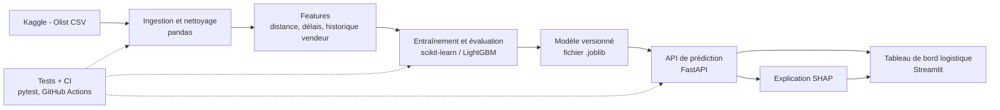

# Étude de conception – Prédiction de retard de livraison
Groupe : [noms]  ·  Version : brouillon  ·  Date : 02/11/2026

---

## 1. Contexte et utilisateurs
- Organisation ou situation : Place de marché e-commerce (type Olist, Brésil) où des vendeurs indépendants expédient des commandes via des transporteurs. Chaque commande a une date de livraison estimée annoncée au client. Les retards dégradent la satisfaction (avis négatifs, réclamations, remboursements).
- Utilisateur principal (un rôle précis) : **Responsable des opérations logistiques** (gestionnaire de la performance de livraison), qui pilote les relances vendeurs/transporteurs et la communication proactive vers les clients.

## 2. Problème et décision
- Décision que l'utilisateur prend avec le système : pour chaque commande validée, décider **si elle doit être signalée « à risque de retard »** et déclencher une action (relance du vendeur, changement de transporteur, message proactif au client, révision de la date promise).
- Fréquence : à chaque commande (ordre de grandeur : ~100 000 commandes sur 2 ans dans le jeu de données, soit ~140/jour), avec un tableau de bord consulté chaque jour.
- Conséquence d'une erreur, et pour qui :
  - **Faux négatif** (retard non détecté) : le client reçoit son colis en retard sans prévenir → avis négatif, réclamation, remboursement. Coût porté par le client (insatisfaction) et la plateforme (réputation, remboursements).
  - **Faux positif** (retard prédit à tort) : relance ou message inutile → temps perdu pour l'équipe logistique, agacement du vendeur, perte de crédibilité de l'alerte. Coût plus faible, porté par l'équipe logistique et les vendeurs.

## 3. Approche par sous-problème

| Sous-problème | Approche (règles / ML / DL / LLM / RAG) | Pourquoi pas une approche plus simple |
|---|---|---|
| Calcul de la distance vendeur → client et des délais de traitement | **Règles** (formule de Haversine sur les coordonnées des codes postaux, différences de dates) | C'est déterministe : aucun apprentissage nécessaire. |
| Prédire si la commande sera livrée en retard (classification binaire) | **ML classique** (régression logistique comme référence, puis gradient boosting type LightGBM) sur données tabulaires | Une règle unique (« distance > X km ») ignore les interactions (état, poids, vendeur, période de l'année). Le gradient boosting est le standard sur du tabulaire, sans le coût d'un réseau de neurones. |
| Expliquer pourquoi une commande est à risque | **ML explicable** (valeurs SHAP sur le modèle) | Une alerte sans raison n'est pas actionnable pour le responsable logistique. |
| Rédiger le message au client | **Modèles de texte fixes** (templates) | Un LLM ajouterait coût, latence et risque d'erreurs de contenu pour un message de 2 phrases : rejeté. |
| Traitement de texte des avis clients | **Non retenu** | Les avis sont postérieurs à la livraison : fuite d'information (voir section 8). |

Le deep learning, le LLM et le RAG ne sont pas justifiés : données tabulaires de taille moyenne (~100 k lignes) et besoin d'explicabilité.

## 4. Données

| Jeu de données | Source et licence | Volume | Données personnelles ? |
|---|---|---|---|
| **Brazilian E-Commerce Public Dataset by Olist** (commandes, clients, vendeurs, produits, paiements, livraisons, géolocalisation, avis) | Kaggle : <https://www.kaggle.com/datasets/olistbr/brazilian-ecommerce> · Licence **CC BY-NC-SA 4.0** (usage non commercial, attribution, partage dans les mêmes conditions) | ~100 000 commandes (2016–2018), 9 fichiers CSV, ~99 k commandes avec statut et dates | Données **anonymisées** par l'éditeur : identifiants hachés, noms de villes/états, préfixe de code postal (pas d'adresse exacte). Les commentaires d'avis peuvent contenir des informations indirectement identifiantes : ils ne sont **pas utilisés**. |

Définition de la cible : `retard = 1` si `order_delivered_customer_date > order_estimated_delivery_date`, sinon `0`. Seules les commandes livrées (`order_status = delivered`) sont utilisées pour l'entraînement. La proportion de retards (de l'ordre de 8 %) sera confirmée lors de l'analyse exploratoire : la classe est **déséquilibrée**.

Variables disponibles **au moment de la commande** (sans fuite d'information) : état/ville du vendeur et du client, distance, poids et dimensions du produit, prix, frais de port, catégorie, mois/jour de la semaine, délai annoncé (date estimée − date d'achat), historique du vendeur (taux de retard passé calculé sur des commandes antérieures uniquement).

## 5. Métriques, baseline et critères d'acceptation
- Baseline et son résultat :
  - **Baseline 1 (référence triviale)** : toujours prédire « à l'heure ». Exactitude ≈ 92 %, mais **rappel = 0 %** sur les retards : inutile pour la décision.
  - **Baseline 2 (règle simple)** : alerte si le vendeur et le client sont dans des états différents et la distance dépasse un seuil choisi sur le jeu d'entraînement. Résultat : [à mesurer et reporter ici : rappel / précision / PR-AUC].
- Métrique principale et pourquoi : **rappel de la classe « retard » à précision minimale fixée** (complétée par la PR-AUC). Un retard non détecté coûte plus cher qu'une fausse alerte (section 2), et l'exactitude est trompeuse avec ~8 % de retards.
- Critères d'acceptation (un nombre, un jeu de données, une condition) : sur le **jeu de test temporel** (derniers mois, jamais vus à l'entraînement), le modèle doit atteindre un **rappel ≥ 60 % avec une précision ≥ 35 %** sur la classe retard, et une **PR-AUC au moins 2× supérieure à la baseline 2**. Sinon, le modèle n'est pas déployé.

## 6. Architecture prévue (après la séance 5)

Flux : les données brutes sont nettoyées, transformées en variables, utilisées pour entraîner puis évaluer le modèle sur un découpage temporel. Le modèle sauvegardé est servi par une API ; le tableau de bord affiche les commandes à risque triées par probabilité, avec les facteurs explicatifs.

## 7. Choix technologiques (après la séance 5)

| Besoin | Outil | Justification |
|---|---|---|
| Récupérer le jeu de données | Kaggle (téléchargement manuel ou API Kaggle) | Source officielle du jeu de données, licence connue. |
| Nettoyage et features | Python + pandas | Standard pour le tabulaire de ~100 k lignes ; pas besoin de Spark. |
| Modèles et évaluation | scikit-learn, LightGBM | Baseline (régression logistique) et modèle final performant sur le tabulaire, entraînement en quelques minutes sur un portable. |
| Explicabilité | SHAP | Montre les facteurs de chaque alerte, nécessaire pour que le responsable logistique agisse. |
| Servir les prédictions | FastAPI | API légère, validation des entrées, documentation automatique. |
| Interface utilisateur | Streamlit | Tableau de bord en Python, rapide à construire pour un prototype. |
| Qualité et reproductibilité | pytest, GitHub Actions, `requirements.txt` | Tests automatiques à chaque push, environnement reproductible. |
| Déploiement | Docker | Même environnement en local et en démonstration. |

## 8. Risques, éthique, confidentialité
**Les huit questions :**

1. **Les données contiennent-elles des données personnelles ? Lesquelles ?** Peu : identifiants clients hachés et préfixes de code postal. Le jeu est anonymisé par l'éditeur. Mesure : vérifier qu'aucune colonne de texte libre (avis) ni identifiant brut n'est conservée dans les variables du modèle ; contrôle automatisé de la liste des colonnes utilisées.
2. **Peut-on s'en passer ou les anonymiser ?** Oui : le modèle n'a besoin ni du nom ni de l'identifiant client, seulement de la localisation approximative (état, distance). Mesure : supprimer `customer_unique_id` et les avis du jeu d'entraînement ; aucune de ces colonnes dans le pipeline final.
3. **Qui peut être lésé par une erreur ?** Les clients dont le retard n'est pas signalé (faux négatifs), et les vendeurs injustement signalés (faux positifs). Risque d'effet injuste sur les vendeurs de régions éloignées. Mesure : comparer rappel et taux de fausses alertes **par état** ; écart maximal toléré de 15 points entre états.
4. **Les données couvrent-elles tous les cas d'usage (lieux, périodes, populations) ?** Non : uniquement le Brésil, 2016–2018, un seul marketplace ; peu de commandes dans le Nord et le Nord-Est. Périodes spéciales (Black Friday, grève des camionneurs de 2018) sous-représentées. Mesure : nombre de commandes par état et par mois, états avec moins de 500 commandes signalés comme « prédiction peu fiable ».
5. **Quelle erreur coûte le plus, et à qui ?** Le faux négatif : le client subit le retard sans information, la plateforme perd en réputation et rembourse. Mesure : coût relatif fixé à 5 faux positifs ≈ 1 faux négatif pour le choix du seuil d'alerte.
6. **Qui valide les décisions, et peut les corriger ?** Le responsable logistique décide de l'action ; le système ne fait que **recommander**. Aucune annulation de commande ni pénalité vendeur automatique. Mesure : toute alerte affiche ses facteurs explicatifs, et l'utilisateur peut la marquer « fausse alerte » ; ces retours sont journalisés pour le réentraînement.
7. **Des données sortent-elles de l'organisation (API externe) ?** Non dans l'architecture prévue : modèle et API hébergés en interne, pas d'appel à un LLM externe. Mesure : aucune dépendance à un service tiers dans le code d'inférence ; vérification par revue du fichier de dépendances.
8. **Comment le système pourrait-il être détourné ?** Un vendeur pourrait manipuler les variables déclarées (poids, délai de traitement) pour obtenir un score favorable, ou le score pourrait être utilisé pour pénaliser des vendeurs sans validation humaine. Mesure : seules les variables vérifiables par la plateforme sont utilisées (dates réelles, géographie) ; le score n'est jamais utilisé seul pour une sanction.

**Risques supplémentaires :**
- *Fuite d'information (data leakage)* : utiliser des variables postérieures à la commande (date de livraison réelle, avis) gonflerait artificiellement les performances. Mesure : liste explicite des variables autorisées et découpage temporel strict.
- *Dérive des données* : les délais évoluent avec le temps. Mesure : suivre le rappel mensuel ; réentraîner si le rappel passe sous 50 % pendant 2 mois consécutifs.

## 9. Limites et hors périmètre
**Limites :**
- Données historiques d'un seul marketplace brésilien (2016–2018) : la généralisation à un autre pays ou à une autre période n'est pas démontrée.
- Licence CC BY-NC-SA : usage académique et non commercial uniquement.
- La date estimée de livraison est elle-même fixée par la plateforme : on prédit un retard **par rapport à cette promesse**, pas un délai absolu.
- Les causes réelles (météo, grèves, ruptures de stock) ne sont pas dans les données.

**Hors périmètre (explicite) :**
- Optimisation des itinéraires ou choix automatique du transporteur.
- Prédiction du délai exact en jours (seulement retard oui/non).
- Analyse des avis clients par NLP / LLM.
- Mise en production réelle, intégration à un système d'information existant, et connexion à des données en temps réel.
- Remboursements et sanctions automatiques des vendeurs.
